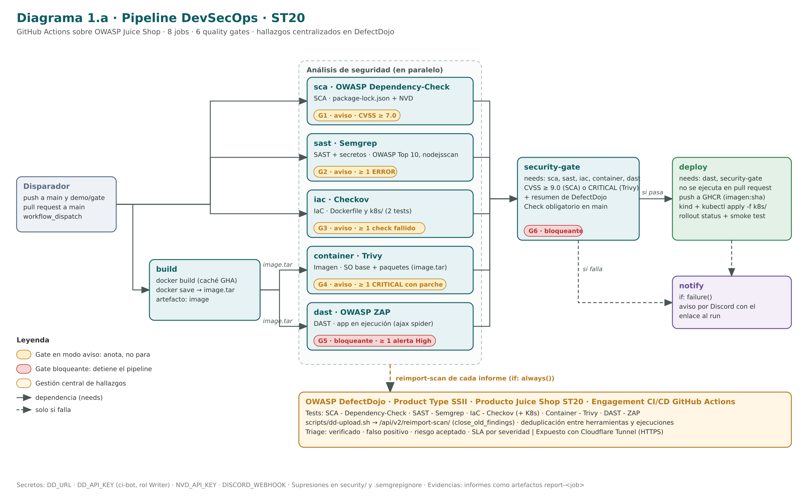
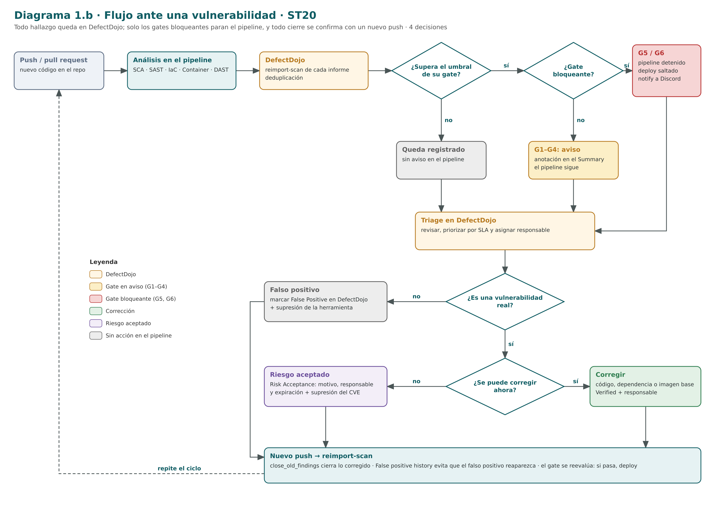
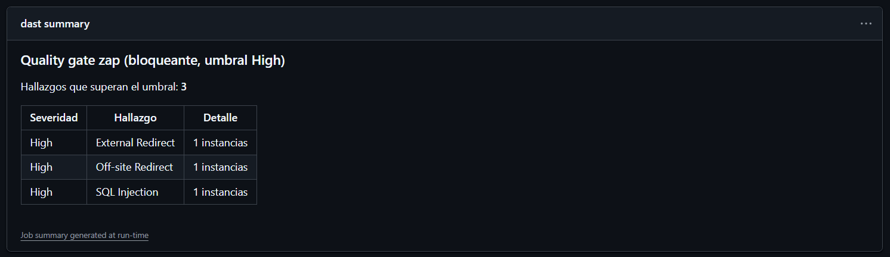
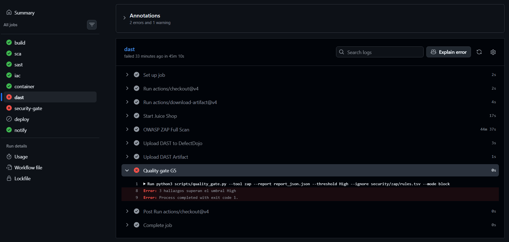
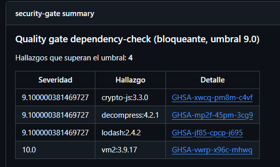
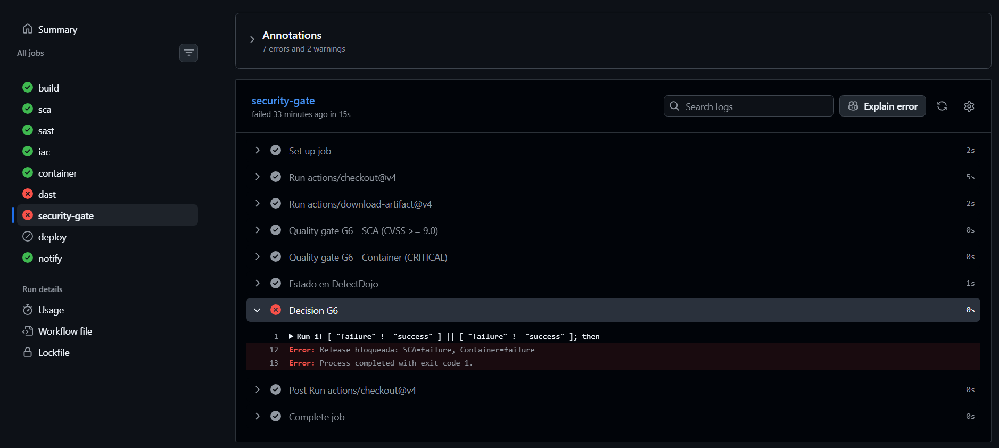
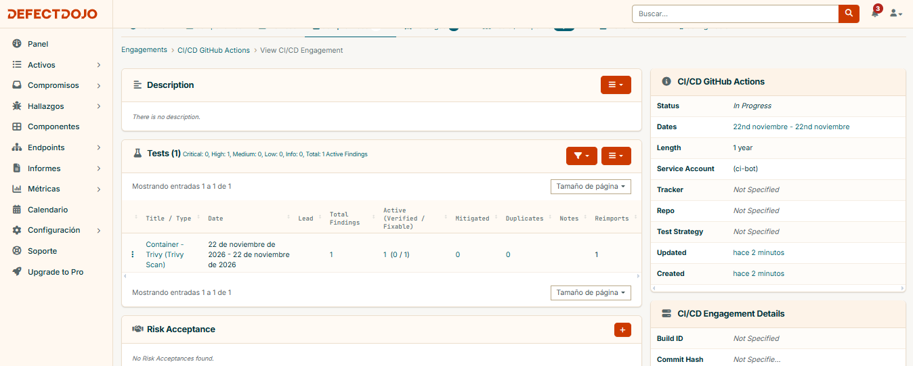
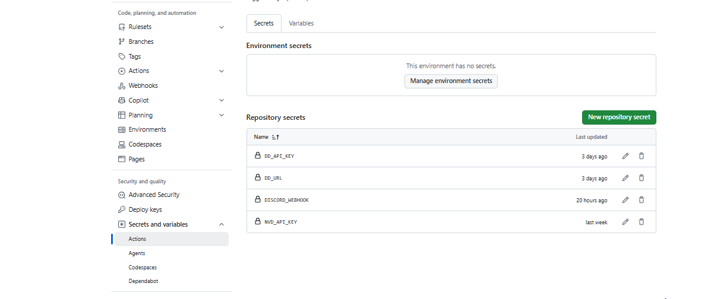

# 1. Introducción y contexto

El cliente, una empresa de desarrollo web, ha sufrido incidentes de seguridad. Su pipeline de integración y despliegue continuo compila y publica el software sin comprobar la seguridad del código, de las dependencias ni de la configuración. Además, está migrando a microservicios en contenedores sobre Kubernetes, lo que multiplica la superficie expuesta. Nos pide dos cosas: saber si los incidentes se explican por su forma de trabajar y una propuesta para evitarlos.

Como *Yellow Team*, quien construye el software automatiza también sus pruebas de seguridad. Hemos montado un pipeline DevSecOps completo en GitHub Actions sobre OWASP Juice Shop. El pipeline:

- Analiza la aplicación con cinco herramientas de cuatro tipos (SCA, SAST, IaC y DAST, más el análisis de la imagen).
- Aplica seis *quality gates*, dos de ellos bloqueantes.
- Centraliza todos los hallazgos en OWASP DefectDojo.
- Despliega la aplicación en un clúster de Kubernetes efímero, pero solo si supera los gates.

**Repositorio:** <https://github.com/alvmornav/ST20-PAI4-DevSecOps>

| Elemento | Ubicación en el repositorio |
| --- | --- |
| Pipeline | `.github/workflows/devsecops.yml` |
| Scripts de subida y gates | `scripts/` (`dd-upload.sh`, `quality_gate.py`, `rol_b_parsers.py`, `dd-gate-summary.sh`) |
| Supresiones y reglas | `security/`, `.semgrepignore` |
| Escenario Kubernetes | `k8s/` |
| DefectDojo | `defectdojo/README.md` |
| Diagramas 1.a y 1.b | `docs/diagramas/` |
| Evidencias | `evidencias/` (índice en `EVIDENCIAS_POR_ROL.md`) |

**Respuesta corta al cliente:** sí. Ninguna etapa de su pipeline verificaba la seguridad, y en una sola ejecución del nuestro aparecen cientos de vulnerabilidades en las cinco capas analizadas. Es el tipo de problema que acaba en incidentes. El apartado 7 desarrolla la respuesta.

# 2. Aplicación y herramientas seleccionadas

**Aplicación: OWASP Juice Shop 17.1.1.** Está hecha con Node.js (Express) y Angular/TypeScript, trae un Dockerfile y tiene vulnerabilidades intencionadas en todas las capas que queremos analizar:

- Código propio (inyecciones, secretos).
- Dependencias antiguas.
- Configuración del contenedor.
- Fallos que solo aparecen en ejecución (cabeceras, CORS, redirecciones).

Su imagen se puede escanear y desplegar, lo que encaja con el escenario de contenedores del cliente. Las alternativas eran peores: WebGoat (Java) obligaba a usar Maven y herramientas más lentas, y DVWA apenas tiene dependencias para el SCA.

**CI/CD: GitHub Actions.** No requiere servidor propio (Jenkins), `continue-on-error` proporciona el modo aviso y el repositorio público tiene minutos de ejecución ilimitados.

| Tipo | Herramienta | Por qué esta | Parser en DefectDojo |
| --- | --- | --- | --- |
| SCA | OWASP Dependency-Check | Libre, con analizadores de Node (`package-lock.json`) y base NVD con clave de API | Dependency Check Scan |
| SAST + secretos | Semgrep CE | Reglas mantenidas para JS/TS y Express (`p/owasp-top-ten`, `p/nodejsscan`, `p/secrets`). Tarda menos de 1 minuto y no necesita servidor, a diferencia de SonarQube | Semgrep JSON Report |
| IaC | Checkov | Analiza el Dockerfile y los manifiestos de Kubernetes con identificadores `CKV_DOCKER_*` y `CKV_K8S_*` | Checkov Scan |
| Contenedor | Trivy | Complementa al SCA: ve los paquetes del sistema base y los `node_modules` de la imagen que se desplegaría | Trivy Scan |
| DAST | OWASP ZAP | Acción oficial, *ajax spider* para la SPA de Angular y fichero de reglas para falsos positivos | ZAP Scan |
| Gestión | DefectDojo | API v2 con `reimport-scan`, deduplicación y parser para todas las anteriores | — |

IAST queda fuera porque las herramientas son comerciales y no aportan nada que no cubran SAST y DAST juntos. Como control continuo fuera del pipeline se ha activado Dependabot (npm, Docker y GitHub Actions).

# 3. Diseño del pipeline

## 3.1. Pipeline (diagrama 1.a)

{width=100%}

El workflow se ejecuta en cada *push* a `main`, en cada *pull request* hacia `main` y bajo demanda. Tiene nueve jobs:

| Job | Depende de | Función | Gate |
| --- | --- | --- | --- |
| `build` | — | Construye la imagen (Bookworm + distroless) y la publica como artefacto `image` | — |
| `sca` | — | Dependency-Check sobre `package-lock.json` | G1 (aviso) |
| `sast` | — | Semgrep sobre el código | G2 (aviso) |
| `iac` | — | Checkov sobre el Dockerfile y `k8s/` | G3 (aviso) |
| `container` | `build` | Trivy sobre `image.tar` | G4 (aviso) |
| `dast` | `build` | Arranca la imagen y lanza un *full scan* de ZAP | **G5 (bloqueante)** |
| `security-gate` | los cinco anteriores | Gate de release y resumen del estado en DefectDojo | **G6 (bloqueante)** |
| `deploy` | `dast`, `security-gate` | Publica en GHCR y despliega en kind con *smoke test*. No se ejecuta en pull requests | — |
| `notify` | `dast`, `security-gate`, `deploy` | Si algo falla, avisa por Discord con el enlace al run | — |

Cada job de análisis sigue el mismo patrón:

1. Escanea sin fallar por los hallazgos.
2. Sube el informe a DefectDojo con `scripts/dd-upload.sh` (`if: always()`).
3. Guarda el informe como artefacto `report-<job>`.
4. Evalúa su gate, también con `if: always()`, para que el gate se ejecute aunque DefectDojo no esté accesible.

Los secretos (`DD_URL`, `DD_API_KEY` del usuario de servicio `ci-bot`, `NVD_API_KEY` y `DISCORD_WEBHOOK`) están en GitHub Actions y nunca en el código. El workflow solo tiene permiso de lectura, salvo `deploy`, que necesita `packages: write`. La rama `main` exige *pull request* con aprobación y `security-gate` como *check* obligatorio.

DefectDojo se ejecuta con Docker Compose en un equipo del grupo y se expone a los runners mediante Cloudflare Tunnel, una conexión HTTPS saliente que no requiere abrir puertos.

**Cambios respecto al diseño inicial:**

- Las imágenes base se migraron a Debian Bookworm, porque los repositorios de Buster ya están archivados y el build fallaba.
- La subida a DefectDojo pasó de `import-scan` a `reimport-scan`. Con `import-scan` el producto llegó a acumular 31 tests y 4.450 hallazgos inflados.
- El gate contra la API de DefectDojo que se probó al principio quedó como **paso informativo** de `security-gate`. Depende de que el túnel esté activo y cuenta todo el producto, así que no decide la release.
- Checkov se ejecuta una vez por *framework*, y el informe de Kubernetes va en un test propio (*IaC - Checkov K8s*) para que `reimport-scan` no lo sobrescriba.
- El *deployment* incluye una `readinessProbe`, porque `kubectl rollout status` la necesita. El resto de controles se dejó sin endurecer a propósito.
- La demostración de despliegue tras aceptar riesgos (rama `demo/gate`) se descartó por indicación de la profesora. La evidencia central es el run de `main` con los gates bloqueantes disparados.

## 3.2. Flujo ante una vulnerabilidad (diagrama 1.b)

{width=92%}

El flujo parte de un principio: **todo hallazgo queda registrado en DefectDojo**, pero solo los gates bloqueantes paran el pipeline, y ningún hallazgo se cierra hasta que un análisis posterior lo confirma.

1. **¿Supera el umbral de su gate?** Si no lo supera, queda registrado y entra en el triage ordinario según su SLA.
2. **¿Es bloqueante?**
   - G1–G4 dejan el job en verde con una anotación y una tabla en el *Summary*.
   - G5 y G6 hacen fallar el job: `deploy` se salta, `notify` avisa y, como `security-gate` es *check* obligatorio, tampoco se puede fusionar la *pull request*.
3. **¿Es real?** Si es un falso positivo, se marca como *False Positive* en DefectDojo y se añade la supresión equivalente en el repositorio. Con *False positive history* activado, no se reabre.
4. **¿Se corrige ahora?**
   - Si se corrige, se modifica el código, la dependencia o la imagen.
   - Si no, se registra una *Risk Acceptance* con motivo, responsable y caducidad, y se suprime el CVE con la misma fecha.

Toda supresión entra por *pull request* revisada por otro miembro. El siguiente `reimport-scan` cierra lo corregido (`close_old_findings`) y vuelve a evaluar los gates.

# 4. Integración de las herramientas y quality gates

Los seis gates usan un único script, `scripts/quality_gate.py`. El script lee el informe del artefacto (no la API de DefectDojo), aplica el umbral, escribe una tabla en el *Summary* del run y termina con error si se supera el umbral. Los parsers de las cuatro herramientas de build están en `scripts/rol_b_parsers.py`, y el de ZAP, en el propio script.

| Gate | Herramienta | Umbral | Modo |
| --- | --- | --- | --- |
| G1 | Dependency-Check | ≥ 1 dependencia con CVSS v3 ≥ 7.0 | Aviso |
| G2 | Semgrep | ≥ 1 hallazgo ERROR | Aviso |
| G3 | Checkov | ≥ 1 check fallido | Aviso |
| G4 | Trivy | ≥ 1 CRITICAL con versión corregida | Aviso |
| G5 | ZAP | ≥ 1 alerta High no ignorada | **Bloqueante** |
| G6 | Dependency-Check + Trivy | CVSS ≥ 9.0, o ≥ 1 CRITICAL con versión corregida en la imagen | **Bloqueante** |

**Por qué unos avisan y otros bloquean.** Juice Shop es vulnerable a propósito: cualquier umbral razonable en los análisis estáticos se supera siempre, y si G1–G4 bloquearan, el pipeline estaría permanentemente en rojo. Los análisis estáticos tienen además más falsos positivos: Semgrep detecta patrones, no explotaciones. Por eso G1–G4 llevan `continue-on-error: true`.

**G5 bloquea** porque una alerta High de ZAP se obtiene atacando la aplicación en ejecución. Es la evidencia más cercana a una explotación real que produce el pipeline.

**G6 es el gate de release.** Usa umbrales más altos que G1 y G4 porque decide si se despliega. En Trivy solo cuenta las vulnerabilidades con parche, porque bloquear por una vulnerabilidad del sistema base sin corrección dejaría el pipeline parado sin que el equipo pudiera hacer nada. Si falta un informe, G6 también falla: una release sin análisis no se da por buena.

**ZAP** arranca la imagen recién construida y ejecuta un *full scan* con *ajax spider* (`-j`, máximo 5 minutos de spider) y el fichero `security/zap/rules.tsv`. Ese fichero ignora cuatro alertas informativas, cada una justificada, y ninguna afecta a G5.

## 4.1. Ejecución de referencia: run #48 en `main`

La ejecución que documenta el comportamiento de los gates es el **run #48 de `main`** (commit `633864c`, 46 min 26 s), lanzado al fusionar la *pull request* #14.

{width=100%}

| Job | Resultado | Duración |
| --- | --- | --- |
| `build` | Correcto | 43 s |
| `sca`, `sast`, `iac`, `container` | Correctos, con aviso de G1–G4 y subida a DefectDojo | 1 min 52 s · 38 s · 29 s · 47 s |
| `dast` | **Fallo por G5**: 3 alertas High | 45 min 10 s (escaneo: 44 min 37 s) |
| `security-gate` | **Fallo por G6**: «Release bloqueada: SCA=failure, Container=failure» | 15 s |
| `deploy` | Saltado | — |
| `notify` | Aviso enviado a Discord con el enlace al run | 3 s |

**G5** se disparó por tres alertas High: **SQL Injection** en `/rest/products/search` (parámetro `q`), **External Redirect** y **Off-site Redirect** en `/redirect?to=`.

**G6** se disparó por los dos lados:

- **Dependency-Check:** 4 dependencias con CVSS ≥ 9.0. Son `crypto-js` 3.3.0, `decompress` 4.2.1 y `lodash` 2.4.2, con 9.1, y `vm2` 3.9.17, con 10.0.
- **Trivy:** 41 vulnerabilidades CRITICAL con versión corregida. De ellas, 32 son de `vm2` 3.9.17; el resto, de `crypto-js`, `jsonwebtoken`, `lodash`, `tar`, `form-data` y una del sistema (`libssl3`).

El paso informativo de DefectDojo contabilizó **89 críticas activas sin gestionar**.

El pipeline impide desplegar una imagen con vulnerabilidades críticas conocidas y con explotaciones confirmadas en ejecución, y avisa al equipo. Las tablas de G5 y G6, los pasos en rojo y el aviso de Discord están en el Anexo A.

# 5. Resultados por herramienta

Todas las cifras proceden de los informes del run #48 (`evidencias/informes/`).

| Herramienta | Resultado | Por severidad |
| --- | --- | --- |
| Dependency-Check | 37 de 43 dependencias vulnerables; 141 vulnerabilidades | 44 critical · 45 high · 48 moderate · 4 low |
| Semgrep | 102 hallazgos | 31 ERROR · 61 WARNING · 5 MEDIUM · 5 INFO |
| Checkov | Dockerfile: 5 checks fallidos (331 superados) · Kubernetes: 19 fallidos (71 superados) | — |
| Trivy | 287 vulnerabilidades (102 del sistema Debian 12, 158 de Node.js, 27 del binario `tsc`) y 4 secretos | 47 critical · 77 high · 117 medium · 41 low · 5 unknown |
| ZAP | 46 tipos de alerta | 3 high · 10 medium · 13 low · 20 informativas |

**Dependency-Check (SCA).** `vm2` 3.9.17 (CVSS 10.0) permite escapar del *sandbox* y ejecutar código en el servidor. Corrección: actualizar a una versión parcheada o eliminar la dependencia, ya que el proyecto `vm2` está abandonado. `lodash` 2.4.2 arrastra la contaminación de prototipo CVE-2019-10744. Corrección: `lodash` ≥ 4.17.12.

**Semgrep (SAST).** Hay inyección SQL por concatenación de cadenas en `routes/login.ts:36` y en `routes/search.ts:23`, donde se construye `SELECT * FROM Products WHERE name LIKE '%${criteria}%'`. Corrección: consultas parametrizadas con *replacements* de Sequelize. También aparecen SSRF en `routes/profileImageUrlUpload.ts:18`, deserialización YAML insegura en `server.ts:59` e inyecciones NoSQL en `routes/order.ts`, `wallet.ts` y otros.

**Checkov (IaC).** El *deployment* de `k8s/01-deployment.yaml` no define `securityContext` (CKV_K8S_29/30), admite ejecución como root (CKV_K8S_23) y escalada de privilegios (CKV_K8S_20), no tiene límites ni reservas de CPU y memoria (CKV_K8S_10–13), ni `livenessProbe` (CKV_K8S_8), y usa la etiqueta `latest` (CKV_K8S_14). El Dockerfile no declara `HEALTHCHECK` (CKV_DOCKER_2). Es exactamente el punto de partida sin endurecer que se quería reproducir. Corrección: añadir `securityContext` con `runAsNonRoot`, `readOnlyRootFilesystem` y `allowPrivilegeEscalation: false`, más límites, sondas y una etiqueta fija.

**Trivy (contenedor).** Confirma desde la imagen los paquetes de Node que señala Dependency-Check y añade lo que el SCA no ve: el sistema base (CVE-2026-31789 en `libssl3`, corregido en 3.0.19) y dos claves privadas embebidas en `lib/insecurity.ts` y en su versión compilada. Corrección: reconstruir sobre una imagen base actualizada y sacar las claves a secretos.

**ZAP (DAST).** La **inyección SQL** en `/rest/products/search?q=` devuelve un error 500 con la carga `'(`. Es la misma vulnerabilidad que Semgrep señala en `routes/search.ts:23`, y aquí se confirma en ejecución: el SAST localiza el fallo en el código y el DAST demuestra que es explotable. Las dos **redirecciones abiertas** (CWE-601) en `/redirect?to=` permiten llevar al usuario a un dominio arbitrario. Entre las Medium destacan la exposición de copias de seguridad en `/ftp/` (31 instancias), una configuración de CORS permisiva, la ausencia de CSP y jQuery 2.2.4 vulnerable. Corrección: consultas parametrizadas, lista blanca de destinos de redirección y cabeceras de seguridad.

Todas las herramientas detectaron al menos una vulnerabilidad, como exige el objetivo 4.

# 6. Gestión en DefectDojo

## 6.1. Organización e ingestión

| Nivel | Valor |
| --- | --- |
| Product Type / Product | SSII / Juice Shop ST20 |
| Engagement | CI/CD GitHub Actions (único y continuo) |
| Tests | SCA - Dependency-Check · SAST - Semgrep · IaC - Checkov · IaC - Checkov K8s · Container - Trivy · DAST - ZAP |

El pipeline sube los informes con `POST /api/v2/reimport-scan/` usando el usuario de servicio **ci-bot**, que solo tiene rol *Writer* sobre el producto. Si su clave se filtrara, no daría acceso al resto de la instancia. Cada importación guarda el run, el commit y la rama. El hallazgo CVE-2026-22709 (`vm2`, Critical 9,8) muestra en su ficha la ruta del componente, *Fix Available: True*, el SLA en curso y que lo subió `ci-bot` (Anexo A).

## 6.2. Deduplicación

Hay deduplicación en dos niveles:

- **Entre ejecuciones.** `reimport-scan` actualiza el test existente en lugar de crear uno nuevo. Los hallazgos que se repiten quedan como *untouched*, los nuevos se añaden y los que desaparecen se cierran como *Mitigated*. Se comprobó con dos subidas seguidas del mismo informe, que no cambiaron el número de tests ni de hallazgos. Tras varias ejecuciones, el producto tiene **602 hallazgos abiertos**, frente a los 4.450 que llegó a acumular con `import-scan`.
- **Entre herramientas.** Con *Deduplicate findings* y `deduplication_on_engagement=true`, un mismo CVE detectado por dos herramientas se marca como duplicado. Es el caso esperable de las librerías de Node que detectan a la vez Dependency-Check, desde `package-lock.json`, y Trivy, desde la imagen: `vm2`, `lodash` o `crypto-js`. El resumen de `security-gate` cuenta por ello solo las críticas activas **no duplicadas**: 89 en el run #48.

## 6.3. Clasificación y priorización

DefectDojo aplica un SLA por severidad y muestra en cada hallazgo los días restantes: el CVE-2026-22709, Critical, descubierto hace 2 días, tiene 5 días de SLA, es decir, un plazo de 7 días para los Critical.

Aplicando el flujo del diagrama 1.b a los resultados del run #48, la clasificación queda así:

| Clase | Hallazgos | Tratamiento |
| --- | --- | --- |
| Prioridad inmediata (Critical/High reales) | Inyección SQL confirmada por ZAP y Semgrep; `vm2` 3.9.17 (CVSS 10); claves privadas en `lib/insecurity.ts` | *Verified*, responsable asignado y corrección dentro del SLA de 7 días |
| Falso positivo | 4 inyecciones que Semgrep marca en `data/static/codefixes/*.ts`. Son fragmentos de código de los retos que la aplicación muestra como texto y nunca ejecuta | *False Positive* con la justificación y la ruta añadida a `.semgrepignore` |
| Riesgo aceptado | Vulnerabilidades heredadas de Juice Shop sin corrección en el alcance de la práctica, como la cadena de dependencias de `vm2` | *Risk Acceptance* con motivo, responsable y caducidad, y supresión del CVE con la misma fecha de revisión |
| Hallazgo en el propio pipeline | Semgrep marca `scripts/rol_b_parsers.py:9` (`use-defused-xml-parse`): el parser lee XML con `xml.etree`, vulnerable a XXE | Riesgo bajo, porque el XML lo genera Dependency-Check dentro del runner. Se corrige usando `defusedxml` |

Que el pipeline detecte un fallo en su propio código muestra que se analiza todo el repositorio, no solo la aplicación.

# 7. Conclusiones y respuesta al cliente

**Sí: los incidentes del cliente se explican por su forma de trabajar.** Su pipeline compilaba y desplegaba sin que ninguna etapa comprobara la seguridad. Cualquier vulnerabilidad escrita por un desarrollador, heredada de una librería o causada por un Dockerfile o un manifiesto mal configurado llegaba a producción sin que nadie la viera.

Una sola ejecución de nuestro pipeline sobre Juice Shop lo demuestra:

- 141 vulnerabilidades en dependencias, 44 de ellas críticas.
- 31 errores graves en el código.
- 24 fallos de configuración en el contenedor y Kubernetes.
- 287 vulnerabilidades en la imagen, 47 críticas.
- 3 vulnerabilidades altas explotables con la aplicación en marcha, una de ellas la inyección SQL que también localiza el análisis del código.

Cada herramienta encuentra problemas que las demás no ven, así que ninguna basta por sí sola.

La migración a Kubernetes agrava el problema. Cada microservicio añade su código, sus dependencias, su imagen y sus manifiestos. Los manifiestos que reproducen su punto de partida generan 19 fallos de Checkov que en un clúster real permitirían, por ejemplo, ejecutar contenedores como root o agotar los recursos del nodo.

**Qué aporta la solución:**

- **Detección en cada cambio.** Las cinco herramientas se ejecutan en cada *push* y *pull request*, sin intervención manual.
- **Bloqueo de lo grave y aviso de lo demás.** G5 y G6 impidieron desplegar la versión vulnerable y avisaron al equipo (run #48). Como son *checks* obligatorios, tampoco se puede fusionar código que no los supere.
- **Un único punto de gestión.** DefectDojo reúne los resultados de las cinco herramientas, elimina duplicados, cierra automáticamente lo corregido y conserva cada decisión (falso positivo, riesgo aceptado), con autor y fecha.
- **Decisiones trazables.** Un gate solo se desbloquea corrigiendo o aceptando formalmente el riesgo, con una supresión revisada en el repositorio.

**Limitaciones y recomendaciones:**

- **El DAST completo tarda unos 45 minutos.** Conviene un escaneo *baseline* en las *pull requests* y reservar el completo para `main`.
- **DefectDojo en local, con un túnel rápido.** La URL cambia en cada reinicio y obliga a actualizar el secreto. En producción debe ir en un servidor con dominio fijo.
- **Juice Shop es vulnerable por diseño.** En un proyecto real, el volumen inicial sería menor y los gates de aviso podrían pasar a bloqueantes de forma progresiva.
- **Queda pendiente corregir lo detectado en los artefactos del cliente:** `securityContext`, límites y sondas en los manifiestos, y fijar las versiones de las imágenes y de las herramientas del pipeline (aún queda `Dependency-Check_Action@main`).

Recomendamos al cliente adoptar este pipeline como plantilla para cada microservicio: el coste de integrarlo es pequeño frente al de un incidente, y convierte la seguridad en una comprobación automática de cada cambio.

# Declaración de uso de IA

El equipo ha utilizado un asistente de IA generativa (Claude, de Anthropic) como apoyo en la redacción de borradores de scripts y del workflow, en la depuración de errores del pipeline, en la elaboración de los diagramas y en la redacción de este informe. Todo el contenido se ha revisado, ejecutado y validado por el equipo, y las cifras proceden de los informes reales del pipeline.

# Anexo A. Evidencias principales

El índice completo está en `evidencias/EVIDENCIAS_POR_ROL.md`, y los informes de las herramientas, en `evidencias/informes/`.

{width=80%}

{width=100%}

{width=60%}

{width=100%}

{width=70%}

{width=90%}

{width=85%}

{width=85%}
