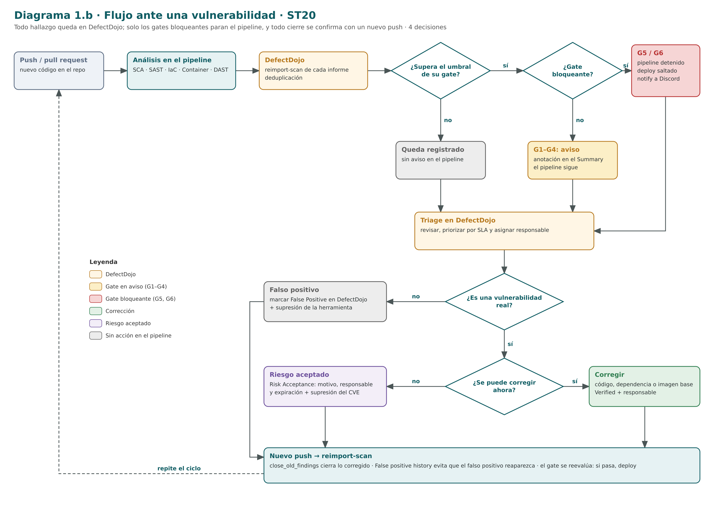

# Informe PAI-4 ST20 — Rol C: apartados 3.2 y 4

> Extracto de la parte del Rol C del informe final (`docs/informe/PAI4-ST20-Informe.md`), con las cifras del run #48 en `main`.

## 3.2. Flujo ante una vulnerabilidad (diagrama 1.b)

{width=92%}

El flujo parte de un principio: **todo hallazgo queda registrado en DefectDojo**, pero solo los gates bloqueantes paran el pipeline, y ningún hallazgo se cierra hasta que un análisis posterior lo confirma.

1. **¿Supera el umbral de su gate?** Si no lo supera, queda registrado y entra en el triage ordinario según su SLA.
2. **¿Es bloqueante?**
   - G1–G4 dejan el job en verde con una anotación y una tabla en el *Summary*.
   - G5 y G6 hacen fallar el job: `deploy` se salta, `notify` avisa y, como `security-gate` es *check* obligatorio, tampoco se puede fusionar la *pull request*.
3. **¿Es real?** Si es un falso positivo, se marca como *False Positive* en DefectDojo y se añade la supresión equivalente en el repositorio. Con *False positive history* activado, no se reabre.
4. **¿Se corrige ahora?**
   - Si se corrige, se modifica el código, la dependencia o la imagen.
   - Si no, se registra una *Risk Acceptance* con motivo, responsable y caducidad, y se suprime el CVE con la misma fecha.

Toda supresión entra por *pull request* revisada por otro miembro. El siguiente `reimport-scan` cierra lo corregido (`close_old_findings`) y vuelve a evaluar los gates.

## 4. Integración de las herramientas y quality gates

Los seis gates usan un único script, `scripts/quality_gate.py`. El script lee el informe del artefacto (no la API de DefectDojo), aplica el umbral, escribe una tabla en el *Summary* del run y termina con error si se supera el umbral. Los parsers de las cuatro herramientas de build están en `scripts/rol_b_parsers.py`, y el de ZAP, en el propio script.

| Gate | Herramienta | Umbral | Modo |
| --- | --- | --- | --- |
| G1 | Dependency-Check | ≥ 1 dependencia con CVSS v3 ≥ 7.0 | Aviso |
| G2 | Semgrep | ≥ 1 hallazgo ERROR | Aviso |
| G3 | Checkov | ≥ 1 check fallido | Aviso |
| G4 | Trivy | ≥ 1 CRITICAL con versión corregida | Aviso |
| G5 | ZAP | ≥ 1 alerta High no ignorada | **Bloqueante** |
| G6 | Dependency-Check + Trivy | CVSS ≥ 9.0, o ≥ 1 CRITICAL con versión corregida en la imagen | **Bloqueante** |

**Por qué unos avisan y otros bloquean.** Juice Shop es vulnerable a propósito: cualquier umbral razonable en los análisis estáticos se supera siempre, y si G1–G4 bloquearan, el pipeline estaría permanentemente en rojo. Los análisis estáticos tienen además más falsos positivos: Semgrep detecta patrones, no explotaciones. Por eso G1–G4 llevan `continue-on-error: true`.

**G5 bloquea** porque una alerta High de ZAP se obtiene atacando la aplicación en ejecución. Es la evidencia más cercana a una explotación real que produce el pipeline.

**G6 es el gate de release.** Usa umbrales más altos que G1 y G4 porque decide si se despliega. En Trivy solo cuenta las vulnerabilidades con parche, porque bloquear por una vulnerabilidad del sistema base sin corrección dejaría el pipeline parado sin que el equipo pudiera hacer nada. Si falta un informe, G6 también falla: una release sin análisis no se da por buena.

**ZAP** arranca la imagen recién construida y ejecuta un *full scan* con *ajax spider* (`-j`, máximo 5 minutos de spider) y el fichero `security/zap/rules.tsv`. Ese fichero ignora cuatro alertas informativas, cada una justificada, y ninguna afecta a G5.

### 4.1. Ejecución de referencia: run #48 en `main`

La ejecución que documenta el comportamiento de los gates es el **run #48 de `main`** (commit `633864c`, 46 min 26 s), lanzado al fusionar la *pull request* #14.

{width=100%}

| Job | Resultado | Duración |
| --- | --- | --- |
| `build` | Correcto | 43 s |
| `sca`, `sast`, `iac`, `container` | Correctos, con aviso de G1–G4 y subida a DefectDojo | 1 min 52 s · 38 s · 29 s · 47 s |
| `dast` | **Fallo por G5**: 3 alertas High | 45 min 10 s (escaneo: 44 min 37 s) |
| `security-gate` | **Fallo por G6**: «Release bloqueada: SCA=failure, Container=failure» | 15 s |
| `deploy` | Saltado | — |
| `notify` | Aviso enviado a Discord con el enlace al run | 3 s |

**G5** se disparó por tres alertas High: **SQL Injection** en `/rest/products/search` (parámetro `q`), **External Redirect** y **Off-site Redirect** en `/redirect?to=`.

**G6** se disparó por los dos lados:

- **Dependency-Check:** 4 dependencias con CVSS ≥ 9.0. Son `crypto-js` 3.3.0, `decompress` 4.2.1 y `lodash` 2.4.2, con 9.1, y `vm2` 3.9.17, con 10.0.
- **Trivy:** 41 vulnerabilidades CRITICAL con versión corregida. De ellas, 32 son de `vm2` 3.9.17; el resto, de `crypto-js`, `jsonwebtoken`, `lodash`, `tar`, `form-data` y una del sistema (`libssl3`).

El paso informativo de DefectDojo contabilizó **89 críticas activas sin gestionar**.

El pipeline impide desplegar una imagen con vulnerabilidades críticas conocidas y con explotaciones confirmadas en ejecución, y avisa al equipo. Las tablas de G5 y G6, los pasos en rojo y el aviso de Discord están en el Anexo A.
